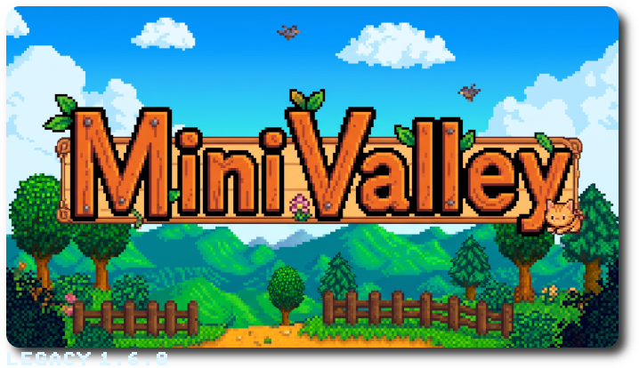

# MiniValley

Stardew Valley 1.6.8 on the Anbernic RG35XX - Legacy Model (Cortex-A9, 256 MB RAM, PowerVR SGX544, 640x480), built from **your own copy** of the PC game optimized for [MiaUI CFW](https://github.com/miaui-cfw).

This repository contains **no game code and no game assets**. It holds the tools that turn your Steam files into a playable pak, using on your own PC.

♨️ This is a new development **for MiaUI**. Consider this my way of saying thank you to all of you for [the warm welcome MiaUI](https://www.reddit.com/r/RG35XX/comments/1xq2n09/miaui_v200_rg35xx_og/) has received on reddit 😽

# How to play MiniValley

MiniValley doesn't contain the game. You build the RG35XX version yourself, on your PC, from the copy of Stardew Valley you own. It takes about 15 minutes the first time.

## What you need
- **Stardew Valley for PC**, bought on Steam, version **legacy_1.6.8**. The build checks the files and warns if they differ.
- **A Linux PC** (or WSL2 on Windows) with **Docker** and about 8 GB of free disk space and 4 GB of RAM.
- **An RG35XX** with [MiaUI](https://github.com/miaui-cfw), and an SD card with about 600 MB free.

## Steps
1. **Install the game on Steam.** Select the correct version (properties / version / legacy_1.6.8) and find its folder: right-click Stardew Valley > Manage > Browse local files. It
   holds `Stardew Valley.dll` and the `Content` folder.
   - On Windows, you can copy that folder into WSL first.
2. **Make the toolchain sysroot once:** `build/make-sysroot.sh`. It needs the Koriki toolchain Docker image (`koriki-toolchain`). Any armhf sysroot whose glibc isn't newer than the device's also works: pass it with   `--sysroot`.
3. **Build:** `./build-pak.sh "/path/to/Stardew Valley"` that compiles everything for the RG35XX with .NET NativeAOT and copies your `Content` files into `out/Stardew Valley.pak`.
4. **Copy `out/Stardew Valley.pak` to `/Ports/` on the SD card.** Start it from the Ports menu.

## Saves
Saves go to `Stardew Valley.pak/StardewValley/Saves/` and are fully compatible with the **1.6.8 PC** game. To continue your legacy farm, copy its folder (for example `Farm_12341234/`) from your PC's `StardewValley/Saves` folder:
- Windows: `%AppData%\StardewValley\Saves`
- Linux: `~/.config/StardewValley/Saves`

## Controls
Buttons work by their RG35XX labels:
- **A:** check, talk, confirm.
- **B:** inventory, cancel.
- **Y:** use tool.
- **X:** crafting.
- **L / R:** toolbar row.
- **Select:** journal.

The full table is in the pak's README.

## Don't share the pak
The built pak contains Stardew Valley. Share MiniValley (this kit), not the pak. Support ConcernedApe by buying the game.

## Legal

Stardew Valley is © ConcernedApe LLC.

MiniValley isn't affiliated with or endorsed by ConcernedApe. Don't distribute the built pak, the patched assemblies or the decompiled sources: they contain the game.
MiniValley's own code is MIT licensed (LICENSE).
Third-party components are listed in THIRD-PARTY-NOTICES.md.

