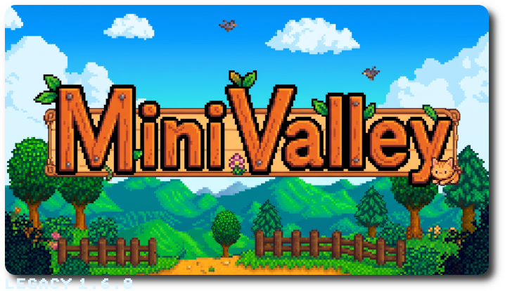

# MiniValley for the RG35XX OG




Built by MiniValley from your own copy of the game. Single player only.

**Don't share this pak: it contains the game.**

## Pak layout

```
Stardew Valley.pak/
  StardewAot           the game (ARM, stripped release build)
  libFAudio.so         FAudio 21.07 for armhf (sound and music)
  gamecontroller.txt   SDL pad mapping (below)
  Content/             from the Steam game, plus the XACT banks
  StardewValley/       saves, settings and error logs (when XDG_CONFIG_HOME/XDG_DATA_HOME point at the pak)
  launch.sh            MinUI/Koriki launcher
```

If you built with `--controllermaps` (from your own Switch copy), the game shows the Joy-Con prompts: A on the right, B at the bottom. Otherwise it shows the PC (Xbox) prompts; the buttons still work by their RG35XX labels.

## How to launch

- **Executable:** `./StardewAot`. No arguments.
- **Working directory:** the pak folder. The game finds `Content/` and `libFAudio.so` next to the binary.
- **Optional `SDV_UI_SCALE` / `SDV_ZOOM`:** both default to `0.5`. This gives whole pixels at 640x480.

## Controls

| Button | In game | In menus |
|---|---|---|
| A (right) | check, talk, harvest | confirm |
| B (bottom) | inventory (pause menu) | back / cancel |
| Y (left) | use tool | right-click action (e.g. take one item) |
| X (top) | crafting menu | closes the menu (the game's own behaviour) |
| Start | inventory | closes the menu |
| Select | journal; skips skippable events | |
| L / R | swap toolbar row | change tabs |
| L2 / R2 | previous / next toolbar item | |
| D-pad | move | move the cursor |


## Saves

The saves are fully compatible with the **1.6.8 PC** version. Copy a PC save folder (for example `Farm_123456789/`) into `<pak>/StardewValley/Saves/`. Saves made on the console can be copied back to a PC.

## Performance (1.2 GHz)

- **Frame rate:** about 60 fps indoors and in town. The farm runs at 30 fps.
- **Memory:** about 139-144 MB RSS in game, with a load peak of about 155-160 MB.
- **Rendering:** The game draws into two 16-bit buffers at twice the screen size.


## Legal

Stardew Valley is © ConcernedApe LLC.

MiniValley isn't affiliated with or endorsed by ConcernedApe. Don't distribute the built pak, the patched assemblies or the decompiled sources: they contain the game.
MiniValley's own code is MIT licensed (LICENSE).
Third-party components are listed in THIRD-PARTY-NOTICES.md.

